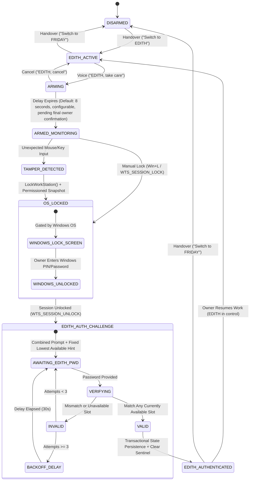

# EDITH V1 Security Mode — Technical Specification & Architecture Design

**Target System:** FRIDAY V2 Desktop Assistant  
**Subsystem:** EDITH V1 Security Mode (`core/edith_security/`)  
**Document Status:** Final Technical Specification for Implementation  
**Date:** 2026-11-23  

---

## Executive Summary

This specification defines the architectural design, security protocols, state machines, and implementation blueprints for integrating **EDITH V1 Security Mode** into the existing FRIDAY V2 desktop application (`D:\F.R.I.D.A.Y`).

### Core Architectural Directives
1. **Strictly Confined Scope:** Focuses exclusively on EDITH V1 Security Mode:
   - Voice handover between FRIDAY and EDITH.
   - Screen wake-lock keeping the display awake and preserving open work and running sessions upon `"EDITH, take care"`.
   - Low-level input perimeter monitoring (mouse displacement and keyboard strikes).
   - Workstation locking (`LockWorkStation()`) triggered by unexpected physical tampering.
   - Two-stage return authentication: native Windows login followed by mandatory EDITH authentication.
   - Five-password independent rotation with fixed-order natural hint delivery.
   - Permission-based incident camera capture with transparent status reporting.
   - Resilient crash recovery with crash-loop prevention.
   - Explicitly out of scope: No separate "Monitor Mode", no network packet sniffing, no malware scanning, no Android companion features, and no remote telemetry.
2. **Zero Regression on Existing FRIDAY Functionality:** All existing capabilities—including bidirectional live voice audio (Gemini Live API), ASUS TUF Aura hardware backlight control, and the existing Private Mode authentication subsystem—remain 100% operational and untouched.
3. **Preservation of `core/edith.py`:** The existing `core/edith.py` policy evaluator (which assigns Risk Levels 0 through 4 to action tools) is strictly preserved and not refactored, overwritten, or modified.
4. **Dedicated Subsystem Namespace:** All security mode code, state machines, hook listeners, and authentication routines reside in a dedicated package: `core/edith_security/`.
5. **Single-Window UI Identity Morphing:** The application reuses the single existing PyQt6 `MainWindow` (`ui.py`). When EDITH is active, the interface dynamically transitions its color palette and typography from FRIDAY's Cyan (`#00f0ff` / `#00b4d8`) to EDITH's tactical Amber/Orange (`#f59e0b` / `#d97706`), updating HUD labels and visual shaders while retaining window handle and audio stream continuity.
6. **Completely Local & Offline Authentication:** EDITH's return authentication operates strictly offline using cryptographic hashes (PBKDF2-HMAC-SHA256 with 600,000 iterations). It has zero dependency on cloud APIs (Gemini) and is completely decoupled from FRIDAY's existing Private Mode credentials.
7. **Two-Stage Authentication Boundary:** EDITH authentication is an application-level identity verification stage that executes *after* the Windows session is authenticated and accessible. EDITH never bypasses or alters Windows OS authentication.

---

## 1. Persona & Voice Cadence

### EDITH Identity & Return Prompt
- **Voice Profile:** EDITH operates with a calm, professional male vocal cadence.
- **Form of Address:** EDITH consistently and respectfully addresses the owner as **"Sir"**.
- **Combined Return Authentication Prompt:**
  When the owner returns and Windows is unlocked, EDITH delivers the exact combined prompt:
  > *"Yes, Sir. Password, please. Your third security concern... is everything alright?"*
  *(Where "third security concern" is dynamically mapped to the fixed-position natural hint associated with the lowest-numbered currently available password slot).*
- **Arming Delay Setting:** The arming countdown is defined as:
  > **Default: 8 seconds, configurable, pending final owner confirmation.**
  *(The duration is set in `config/edith_security.json` and must not be treated as approved until explicitly confirmed by the owner).*

---

## 2. Detailed Module Responsibilities

The subsystem is organized under `core/edith_security/` with clean boundaries:

```
D:\F.R.I.D.A.Y\
├── core/
│   ├── edith.py                  <-- UNTOUCHED: Existing L0-L4 Risk Evaluator
│   └── edith_security/           <-- NEW: Dedicated Security Mode Subsystem
│       ├── __init__.py           <-- Public API exports & lifecycle entry points
│       ├── config.py             <-- Security constants, timeouts, schema models
│       ├── controller.py         <-- EdithSecurityController (Main coordinator)
│       ├── auth_engine.py        <-- 5-Password Independent Rotation & Fixed Hint Engine
│       ├── monitor.py            <-- Low-level Windows hooks, wake-lock & watchdog
│       ├── session_listener.py   <-- Windows Session Notification (WTS) listener
│       ├── camera_capture.py     <-- Permission-based incident snapshot capture
│       ├── incident_logger.py    <-- Structured local event audit logger
│       ├── sentinel.py           <-- Armed sentinel state & crash-loop prevention
│       └── theme.py              <-- PyQt6 UI styling tokens for EDITH identity
├── actions/
│   └── edith_security_action.py  <-- Dynamic tool registration for voice triggers
├── docs/
│   └── EDITH_V1_SPEC.md          <-- This technical specification
└── tests/
    ├── test_edith_auth_rotation.py
    └── test_edith_security_state.py
```

### Module Breakdown

| Module | Primary Responsibility | Critical Interfaces |
| :--- | :--- | :--- |
| `config.py` | Defines immutable constants (hook jitter tolerance, arming delay [default: 8s, configurable, pending final owner confirmation], PBKDF2-HMAC-SHA256 with 600,000 iterations, lockout backoffs) and JSON schema models. | `EdithSecurityConfig`, `AuthSlot` dataclasses |
| `controller.py` | Central coordinator orchestrating the security lifecycle. Manages state transitions, coordinates UI theme morphing, interacts with session listener, and blocks normal assistant tools until authenticated. | `EdithSecurityController.arm()`, `handle_tamper()`, `handle_session_unlocked()`, `verify_return_auth()` |
| `auth_engine.py` | Implements the 5-password independent rotation algorithm. Manages salted PBKDF2-HMAC-SHA256 verifiers (600,000 iterations), enforces 5 distinct enrolled passwords, tracks per-slot independent reuse conditions and cooldown sets, selects fixed-order natural FRIDAY hints for currently available passwords, enforces atomic persistence transactions, and handles master recovery. | `EdithAuthEngine.authenticate(input_pwd)`, `get_available_hint()`, `get_available_slots()`, `recover_with_master_key()` |
| `monitor.py` | Low-level OS interaction layer. Keeps display awake via Windows power execution state APIs, manages low-level mouse and keyboard hooks in a dedicated thread with an idle-resilient Win32 timer heartbeat, handles fail-secure watchdog triggers, and invokes `LockWorkStation()`. | `PerimeterMonitor.start_monitoring()`, `stop_monitoring()`, `acquire_wake_lock()`, `release_wake_lock()` |
| `session_listener.py` | Registers for Windows Session Notifications (`WTSRegisterSessionNotification`) to reliably detect both manual/tamper locks (`WTS_SESSION_LOCK`) and when the user unlocks Windows (`WTS_SESSION_UNLOCK`). | `SessionListener.start()`, `SessionListener.stop()`, Qt signals `session_locked`, `session_unlocked` |
| `camera_capture.py` | Captures webcam still images upon tamper incidents or failed authentication attempts **only when user permission is explicitly enabled**. Accurately logs capture status. | `SecurityCamera.capture_incident_snapshot(reason: str) -> CaptureResult` |
| `incident_logger.py` | Structured, append-only audit logger writing to `logs/edith_security.log`. Emits timestamped, structured logs. Prohibits hallucinated security events. | `IncidentLogger.log_event(event_type, details, image_path, status)` |
| `sentinel.py` | Manages persistent armed state file, accurately computes boot epoch via `GetTickCount64()`, tracks startup recovery attempts, and prevents infinite workstation-lock crash loops while keeping authentication mandatory. | `SentinelManager.mark_armed()`, `check_on_startup()`, `mark_disarmed()`, `record_recovery_attempt()` |
| `theme.py` | Supplies color palettes, style sheets, and avatar visual shader overrides for the EDITH Amber/Orange identity (`#f59e0b`). | `get_edith_stylesheet()`, `apply_edith_theme(window)` |
| `actions/edith_security_action.py` | Action tool dynamically discovered by `core/action_loader.py`. Handles triggers such as `"EDITH, take care"`, `"hand over to EDITH"`, and `"hand over to FRIDAY"`. | `edith_handover()`, `edith_take_care()`, `edith_authenticate()` |

---

## 3. Threading and Process Architecture

The existing FRIDAY architecture operates on a hybrid model:
1. **PyQt6 Main Thread (`ui.py`):** Drives GUI rendering, 30 FPS avatar canvas, and Qt event processing.
2. **Asyncio Worker Thread (`main.py` `_run_live`):** Manages Gemini bidirectional live audio input and output streams.

To guarantee responsiveness, prevent audio drops, and avoid Windows hook timeouts, EDITH V1 distributes work across dedicated, thread-safe boundaries:

```mermaid
flowchart TB
    subgraph UI_Thread ["PyQt6 Main Thread (ui.py)"]
        UI[MainWindow & HoloAvatar]
        ThemeMgr[Theme & Shader Switcher]
        AuthModal[Return Auth Modal / Prompt Display]
    end

    subgraph Live_Thread ["Asyncio Audio Thread (main.py)"]
        GeminiLive[Gemini Live Client / Voice Pipeline]
        ActionRouter[core/action_loader.py]
    end

    subgraph Security_Subsystem ["EDITH Security Subsystem"]
        Controller[EdithSecurityController]
        AuthEng[EdithAuthEngine (PBKDF2-HMAC-SHA256)]
        IncLog[IncidentLogger]
        SentMgr[SentinelManager]
    end

    subgraph Hook_Thread ["Dedicated Windows Hook Thread"]
        MsgPump[Windows Message Pump (MsgWaitForMultipleObjectsEx / WM_TIMER)]
        MouseHook[WH_MOUSE_LL Hook]
        KbdHook[WH_KEYBOARD_LL Hook]
        SessHook[Session Notification Window (WTSRegisterSessionNotification)]
    end

    subgraph Watchdog_Thread ["Watchdog Daemon Thread"]
        HeartbeatCheck[Multi-Tier Heartbeat Monitor (2.0s tick)]
    end

    subgraph Worker_Pool ["Background Worker (ThreadPoolExecutor)"]
        CamWorker[SecurityCamera (OpenCV / DirectShow)]
        DiskIO[Audit Log Writer]
    end

    Live_Thread -- "Voice Trigger ('EDITH, take care')" --> Controller
    Controller -- "Qt Signal: Morph Theme (Amber)" --> ThemeMgr
    Controller -- "Write Armed Sentinel" --> SentMgr
    Controller -- "Start Hook & Wake Lock" --> Hook_Thread
    Hook_Thread -- "Timer Heartbeat Update" --> HeartbeatCheck
    Hook_Thread -- "Tamper Event Detected" --> Controller
    Controller -- "LockWorkStation()" --> OS[Windows Kernel]
    Controller -- "Permission-Checked Snapshot Task" --> CamWorker
    CamWorker -- "Snapshot Result (Path or Error)" --> IncLog
    
    OS -- "User Unlocks Windows (WTS_SESSION_UNLOCK)" --> SessHook
    SessHook -- "Session Unlocked Signal" --> Controller
    Controller -- "Trigger Return Auth Request" --> AuthModal
    AuthModal -- "User Spoken/Typed Password" --> AuthEng
    AuthEng -- "Success Signal (Only if Persisted)" --> Controller
    Controller -- "Clear Armed Sentinel" --> SentMgr
    Controller -- "Unlock Security Mode (EDITH Standby)" --> UI
```

---

## 4. Two-Stage Authentication & State Machine

### Clarification on Windows Login vs. EDITH Authentication
- **Stage 1: Windows OS Authentication:** When tampering is detected or when the user manually locks Windows (`Win+L`), the Windows lock screen appears. The owner must first authenticate using their native Windows credentials (PIN, Password, or Windows Hello). EDITH **never** bypasses or intercepts this stage.
- **Stage 2: EDITH Return Authentication:** Once the Windows session is unlocked and the desktop is accessible (`WTS_SESSION_UNLOCK`), EDITH prompts the owner for EDITH return authentication. All assistant features and tools remain locked until valid EDITH credentials are provided.

### Manual Windows Lock (`Win+L`) Behavior
- If Windows is manually locked via `Win+L` while in `ARMED_MONITORING`:
  1. The `SessionListener` captures `WTS_SESSION_LOCK`.
  2. The state transitions cleanly from `ARMED_MONITORING` to `OS_LOCKED`.
  3. The display wake lock (`SetThreadExecutionState`) is released so Windows can follow its normal lock-screen power policies.
  4. The low-level input hooks remain installed.
  5. The persistent armed sentinel remains active on disk.
  6. When the owner unlocks Windows (`WTS_SESSION_UNLOCK`), EDITH transitions to `EDITH_AUTH_CHALLENGE` and demands return authentication.
  7. **Manual Windows locking cannot bypass EDITH return authentication or create an inconsistent state.**



---

## 5. Password Security & Independent Rotation Algorithm

### 1. Enrollment & Credential Storage Policy
- **Five Distinct Passwords:** Local enrollment strictly requires five mutually distinct passwords ($P_i \neq P_j$ for all $i \neq j \in \{1, 2, 3, 4, 5\}$). Duplicate entries are rejected during enrollment.
- **PBKDF2 Parameter Review:** In alignment with modern OWASP password storage standards, verifiers use:
  $$\text{hash}_i = \text{PBKDF2-HMAC-SHA256}(\text{password}_i, \text{salt}_i, 600\,000\text{ iterations})$$
- **Salted Verifier Storage:** Plaintext passwords are never written to disk or logged. Each credential is stored strictly as a salted verifier with an independent, cryptographically secure 16-byte random salt generated via `secrets.token_bytes(16)`.
- **Entropy & Complexity Distinction:**
  > [!IMPORTANT]
  > **Theoretical Entropy vs. Password Length:** Password length (number of characters) and naive character-class diversity heuristics (e.g. arbitrarily mixing uppercase, lowercase, numbers, and symbols) do **not** mathematically prove high information-theoretic entropy when chosen by humans. Human-selected passwords suffer from severe min-entropy degradation and structural predictability. True theoretical entropy is strictly a function of the size of the search space ($S$) and the number of independent, uniform selections ($L$):
  > $$\text{Entropy} = L \cdot \log_2(S)$$
  > For the Master Recovery Passphrase, the system strictly enforces the selection of five words from the standardized 7,776-word Diceware list, achieving a mathematically verified 64.62 bits of entropy (see Section 8.1).

### 2. Independent Reuse Mathematical Model
Let $S = \{s_1, s_2, s_3, s_4, s_5\}$ be the set of 5 security slots.  
Each slot $s_i$ contains:
- `id`: Integer $\in \{1, 2, 3, 4, 5\}$
- `salt`: Cryptographically secure random 16-byte hex salt
- `hash`: $\text{PBKDF2-HMAC-SHA256}(\text{password}_i, \text{salt}, 600\,000\text{ iterations})$
- `hint`: Natural language hint permanently mapped to this slot index
- `is_available`: Boolean $\in \{\text{True}, \text{False}\}$
- `others_used_since`: Set of slot IDs $O_i \subseteq \{1, 2, 3, 4, 5\} \setminus \{i\}$ representing the distinct passwords used since $s_i$'s last successful authentication.

### Operational Rules
1. **Initial State:** All 5 slots start as available:
   $$\forall s_i \in S: \text{is\_available}(s_i) = \text{True},\quad O_i = \emptyset$$
2. **Non-Sequential Verification:** When an input password $w$ is submitted, it is checked against all slots $s_k$ where $\text{is\_available}(s_k) = \text{True}$. If $w$ matches an unavailable slot, authentication fails (slot is temporarily cooling down).
3. **State Transition Upon Successful Use of Slot $s_k$:**
   - Slot $s_k$ immediately becomes unavailable:
     $$\text{is\_available}(s_k) \leftarrow \text{False},\quad O_k \leftarrow \emptyset$$
   - For every other slot $s_j$ ($j \neq k$):
     - If $s_j$ is currently unavailable ($\text{is\_available}(s_j) = \text{False}$):
       $$O_j \leftarrow O_j \cup \{k\}$$
       - **Independent Reuse Condition:** When all four other passwords have been used at least once since $s_j$'s last use ($|O_j| = 4$):
         $$\text{is\_available}(s_j) \leftarrow \text{True},\quad O_j \leftarrow \emptyset$$
4. **Availability Guarantee Invariant:**
   At any given time, **at least 1 password is mathematically guaranteed to be available**, because at most 4 slots can be cooling down simultaneously:
   $$\sum_{i=1}^5 [\text{is\_available}(s_i) == \text{True}] \ge 1$$
5. **Transactional Consistency Invariant:**
   **Authentication success and the corresponding rotation-state update must be treated as one single logical transaction.** EDITH must never report a completed successful authentication or unlock assistant operations if the resulting rotation state could not be safely committed to disk. If an I/O failure occurs during state persistence, the in-memory update is rolled back, authentication fails, and the system remains locked.
6. **Failed Attempt Invariant:**
   **Failed authentication attempts must never alter the successful-use rotation state or cooldown sets.** A failed attempt increments the consecutive failure counter and updates backoff timers, but leaves $O_i$ and `is_available` states completely untouched.
7. **No Global Batch Reset:** Each password operates strictly on its own independent sliding window.

---

## 6. FRIDAY Natural Hints Integration (Fixed-Order Selection)

### Fixed-Order Selection Algorithm
1. **Permanent Slot Mapping:** Each hint is permanently, immutably bound to its specific slot index:
   - Slot 1 $\to$ Hint 1
   - Slot 2 $\to$ Hint 2
   - Slot 3 $\to$ Hint 3
   - Slot 4 $\to$ Hint 4
   - Slot 5 $\to$ Hint 5
2. **Fixed-Order Lowest Available Selection:**
   When presenting the return authentication prompt, FRIDAY **always selects the lowest-numbered currently available password slot**:
   $$k^* = \min(\{i \in \{1, 2, 3, 4, 5\} \mid \text{is\_available}(s_i) = \text{True}\})$$
   $$\text{selected\_hint} = \text{hint}(s_{k^*})$$
3. **Skipping Inactive Slots:** Any slot $s_j$ with $\text{is\_available}(s_j) = \text{False}$ is skipped.
4. **Non-Sequential Input Permitted:** Although Hint $k^*$ is presented in EDITH's prompt, the owner is **not forced** to enter Password $k^*$. The owner may enter **any** currently available password.
5. **Combined Dialog Cadence:**
   EDITH delivers the prompt incorporating Hint $k^*$:
   > *"Yes, Sir. Password, please. [Hint for slot $k^*$]... is everything alright?"*

---

## 7. Permission-Based Incident Capture & Honest Reporting

### Camera Security Architecture
1. **Explicit Permission Required (No Covert/Silent Capture):** Camera incident capture is controlled by a user setting:
   `"enable_camera_incident_capture": true` (default: false, requiring explicit owner opt-in during setup).
2. **Accurate Status Logging & Reporting:**
   The incident logger records the exact outcome of every capture attempt:
   - `CAPTURE_SUCCESS`: Image acquired and stored at `logs/snapshots/incident_[timestamp].jpg`.
   - `CAPTURE_DISABLED`: User has disabled camera incident capture in settings.
   - `CAPTURE_UNAVAILABLE`: Device in use by another application or hardware absent.
   - `CAPTURE_PERMISSION_DENIED`: OS camera privacy toggle blocked access.
3. **Zero Fabrication:** The system logs only genuine hardware events. If capture fails or is disabled, EDITH truthfully states that camera capture was unavailable or disabled by policy.

---

## 8. Secure Recovery & Realistic Data Integrity

### 1. Master Recovery Passphrase & Exact Entropy Model
- **No Plaintext Key Files:** Plaintext key files (such as `edith_master.key`) will never be written to disk.
- **Strict 64-Bit Mathematical Entropy Calculation:**
  To achieve a mathematically verified $\ge 64$-bit security target:
  - Each word in a standardized Diceware wordlist of $S = 7\,776$ words ($6^5$) provides:
    $$\text{Entropy per word} = \log_2(7\,776) = \frac{\ln(7\,776)}{\ln(2)} \approx 12.9248\text{ bits}$$
  - Selecting **four** words yields:
    $$4 \times 12.9248 = 51.699\text{ bits} < 64\text{ bits}\quad\text{(Insufficient)}$$
  - Selecting **five** words yields:
    $$5 \times 12.9248 = 64.624\text{ bits} \ge 64\text{ bits}\quad\text{(Sufficient)}$$
  - **Requirement:** The word-based Master Recovery Passphrase strictly requires **five randomly selected words** from the standardized 7,776-word Diceware list, uniformly chosen using a cryptographically secure random number generator (`secrets.choice`).
  - **Rejection of Pseudo-Entropy:** Arbitrary freeform character strings, four Diceware words, or character-class diversity heuristics alone are strictly rejected as proof of 64-bit entropy.
- **Cryptographic Verification:**
  - Stored strictly as a salted verifier:
    $$\text{recovery\_hash} = \text{PBKDF2-HMAC-SHA256}(\text{passphrase}, \text{salt}_{\text{rec}}, 600\,000\text{ iterations})$$
  - Verification uses constant-time comparison (`hmac.compare_digest`) to prevent timing side-channel attacks.
- **Recovery Behavior:**
  - Supplying the valid Master Recovery Passphrase resets all 5 standard slots to $\text{is\_available} = \text{True}$, clears all cooldown tracking sets ($O_i = \emptyset$), resets consecutive failure counters to 0, and logs an `EMERGENCY_RECOVERY_AUTHENTICATED` incident.

### 2. State Durability & Checksum Threat Boundary
- **Atomic File Writing:** State serialization writes to a temporary sibling file in `config/`, forces OS write buffer flushing via `os.fsync(f.fileno())`, and executes atomic replacement via `os.replace`.
- **Rotating Shadow Backup:** Before writing `config/edith_auth_state.json`, the existing valid file is backed up to `config/edith_auth_state.json.bak`.
- **Backup Validation & Automatic Fallback:** On application launch, if the primary JSON state file fails JSON parsing, schema validation, or checksum verification, the system automatically validates and restores from `.bak`, logging `STATE_CORRUPTION_RESTORED_FROM_BACKUP`.
- **Accidental Corruption vs. Malicious Modification Boundary:**
  > [!IMPORTANT]
  > The embedded SHA-256 checksum detects **accidental data corruption** (e.g. abrupt power cut, disk write buffer truncation, bit flips). **It does not protect against an attacker with local filesystem write privileges**, as a malicious local user could modify the state and recompute the checksum. Protection against unauthorized local file tampering relies on Windows OS-level file Access Control Lists (ACLs) restricting file write permissions strictly to the owner's Windows user profile.

---

## 9. Failure Recovery, Sentinel Management & Watchdog Architecture

### 1. Persistent Armed Sentinel & Crash-Loop Prevention

```mermaid
flowchart TD
    Start([FRIDAY Launches / Starts Up]) --> ReadSentinel{Does config/edith_sentinel.json Exist?}
    ReadSentinel -- No --> NormalStart[Proceed to Normal Startup (DISARMED)]
    ReadSentinel -- Yes --> ReadFields[Read: armed_epoch, boot_epoch, recovery_attempts]
    
    ReadFields --> CompareBoot{Did System Reboot While Armed?\n(current_boot_epoch != sentinel.boot_epoch)}
    CompareBoot -- Yes --> LogReboot[Log REBOOT_DETECTED_WHILE_ARMED\nPreserve EDITH Auth Requirement]
    CompareBoot -- No --> CheckCrashLoop
    LogReboot --> CheckCrashLoop
    
    CheckCrashLoop{Is recovery_attempts > 2?}
    CheckCrashLoop -- Yes (Crash Loop Detected!) --> EnterFailsafe[Enter FAILSAFE_RECOVERY_MODE:\nDo NOT Lock Workstation!\nDisplay In-App Emergency Auth Modal\nBlock Normal FRIDAY Features\nLog CRASH_LOOP_PREVENTED]
    CheckCrashLoop -- No --> LockAndChallenge[LockWorkStation()\nTransition to LOCKED_AWAITING_AUTH\nRequire Return Authentication]
    
    EnterFailsafe --> AuthDone([User Authenticates with Password or Recovery Passphrase])
    LockAndChallenge --> AuthDone
    AuthDone --> ClearSentinel[Atomically Delete Sentinel File\nReset recovery_attempts to 0]
    ClearSentinel --> Standby[EDITH Active Standby]
```

#### Boot Time Representation & Reboot Handling
- `GetTickCount64()` returns system uptime in milliseconds as a 64-bit integer.
- The system calculates the boot epoch timestamp as:
  $$\text{boot\_epoch} = \text{current\_time\_epoch} - \left(\frac{\text{GetTickCount64()}}{1000.0}\right)$$
- **Reboot Rule:** An armed sentinel is **never** cleared or archived simply because time passed or because the computer rebooted. The requirement for EDITH authentication persists across reboots. If `current_boot_epoch` differs from `sentinel.boot_epoch` by more than a 30-second clock-drift threshold, the system records `REBOOT_DETECTED_WHILE_ARMED` and continues to mandate EDITH authentication.

#### Crash-Loop Recovery & Attempt Counter Rules
- **When Exactly the Counter Increments:**
  `recovery_attempt_count` increments on application launch **if and only if** an active, uncleared armed sentinel (`config/edith_sentinel.json`) is present on disk. The incremented value is immediately persisted to the sentinel file via atomic write (`tempfile` + `os.fsync` + `os.replace`).
- **Which Failures Count as Recovery Attempts:**
  Every launch where the application detects an active armed sentinel and initiates startup recovery counts as one recovery attempt. If the process crashes, terminates, or throws an unhandled exception before return authentication successfully clears the sentinel, that failed execution has expended one attempt. The subsequent startup will find the incremented count.
- **When the Counter Resets:**
  `recovery_attempt_count` resets to 0 **only upon successful return authentication** (or master recovery authentication), at the exact moment the sentinel file is atomically cleared/deleted.
- **Crash Immunity:**
  Because the sentinel file is updated atomically during the increment step, a crash during recovery cannot corrupt the sentinel file or accidentally clear the armed state. Authentication remains strictly mandatory.
- **When `recovery_attempt_count > 2`:**
  - **Workstation remains accessible:** The system suppresses calling `LockWorkStation()` to prevent an inescapable OS lock loop.
  - **Zero Authentication Bypass:** Normal FRIDAY features (voice streaming, action execution, shell commands, tools) remain **strictly disabled**.
  - **Failsafe Modal:** Only the dedicated EDITH authentication/recovery modal accepts input.
  - Normal operation resumes only upon submitting a valid available EDITH password or the Master Recovery Passphrase.

#### Safe Sentinel Clearing
- The sentinel is atomically removed (`os.remove`) strictly *after* successful return authentication or authorized master recovery.

---

### 2. Independent Watchdog Heartbeat & Safe Hook Failure Handling

Because `GetMessage` blocks when no user input is present, the low-level hook thread must not rely solely on input events to prove vitality.

#### Heartbeat Mechanism
The hook thread installs a Win32 timer via `SetTimer(NULL, 0, 1000, NULL)` or utilizes `MsgWaitForMultipleObjectsEx(0, NULL, 1000, QS_ALLINPUT, MWMO_ALERTABLE)` with a 1000ms timeout in its message loop. Every second, even in the complete absence of mouse/keyboard input, the thread awakes and executes:
$$\text{last\_hook\_heartbeat} \leftarrow \text{time.monotonic()}$$

#### Multi-Tier Watchdog Policy (Checked every 2.0s by Watchdog Daemon)
| Silence Duration | Evaluation Tier | System Response |
| :--- | :--- | :--- |
| **$0.0\text{s} - 5.9\text{s}$** | **Tier 1: Transient Scheduling Tolerance** | Normal scheduling jitter, thread priority inversion, or GC pauses. Zero action taken. |
| **$6.0\text{s} - 9.9\text{s}$** | **Tier 2: Probe & Recovery Warning** | Watchdog logs `WATCHDOG_HEARTBEAT_DELAYED` and dispatches a non-blocking `WM_NULL` message via `PostThreadMessageW` to awaken the message pump. |
| **$\ge 10.0\text{s}$** (5 consecutive missed ticks) | **Tier 3: Confirmed Hook Deadlock** | Hook thread is unrecoverable. Watchdog invokes fail-secure `LockWorkStation()` and engages safe hook recovery. |

#### Safe Windows Hook Cleanup & Recovery Policy
> [!WARNING]
> **Win32 Hook Ownership Rule:** In Windows OS, calling `UnhookWindowsHookEx` from a separate watchdog thread on hook handles owned by another thread that has terminated or deadlocked is unsafe and not guaranteed to succeed by the OS. The watchdog thread must **not** attempt or claim to safely unhook handles belonging to a dead thread.
- **Safe Recovery Procedure:**
  1. **Fail-Secure Immediate Action:** Upon detecting $\ge 10.0$s of hook thread silence while in `ARMED_MONITORING`, the watchdog immediately calls `LockWorkStation()`.
  2. **Audit Logging:** The watchdog logs `WATCHDOG_HOOK_THREAD_DEAD_FAILSECURE_ENGAGED`.
  3. **Distinguishing Attempted vs. Confirmed Recovery:** The watchdog marks the dead hook instance as abandoned and signals `EdithSecurityController` to attempt spawning a fresh, isolated `HookThread` with new hook instances (`SetWindowsHookExW`).
  4. **Preserved Lock State:** The workstation remains locked throughout this process. The system does not report successful hook recovery until the new thread successfully pulses its heartbeat. If re-initialization fails, the workstation remains locked and requires native Windows login followed by EDITH return authentication.

---

### 3. Accurate Audit Logging Policy
The audit logger (`logs/edith_security.log`) is an **append-only, structured local event log**.
- Every record includes: ISO 8601 UTC timestamp, monotonic sequence ID, event category (`TAMPER`, `LOCK`, `AUTH_SUCCESS`, `AUTH_FAILURE`, `CAMERA_STATUS`, `RECOVERY`), and execution parameters.
- It does **not** make unsupported claims of "tamper-proof" or "tamper-evident" security without hardware cryptographic backing; it provides accurate, reliable, local forensic event logging.

---

## 10. Test Cases and Regression Strategy

### Automated Test Suite

1. **`tests/test_edith_auth_rotation.py` (Unit Tests — Phase 1 Scope):**
   - **Enrollment Constraints:** Test that attempting to enroll duplicate passwords among the 5 slots raises an error.
   - **Independent Reuse Condition:** Test sequential use of slots (Slot 1 used $\to$ unavailable; Slots 2, 3, 4, 5 used $\to$ Slot 1 re-enabled). Verify Slot 1 cannot be reused when only 3 others have been used.
   - **Mathematical Invariant:** Verify $\ge 1$ password is available across 1,000 random permutations.
   - **Fixed-Order Hint Selection:** Ensure `get_available_hint()` always returns the hint corresponding to $\min(\text{available slots})$. Verify that when Slot 1 is exhausted, Hint 2 is selected.
   - **Failed Attempt Invariant:** Verify that failed password inputs do NOT alter `is_available` states, history, or cooldown sets $O_i$ (only failed attempt counters and backoff timers are modified).
   - **Transactional State Persistence:** Verify that authentication success and rotation-state update are atomic. Simulate an I/O error during state writing and verify that the authentication reports failure and in-memory rotation state rolls back.
   - **State Persistence Across Restart:** Test saving state to disk, re-instantiating `EdithAuthEngine` from disk, and asserting that slot availability, cooldown sets, and usage history match identically.
   - **State Checksum & Simulated Corruption Recovery:** Simulate power loss and corrupt primary JSON file (truncated payload or checksum mismatch); verify that `EdithAuthEngine` detects corruption, restores cleanly from `.bak`, and continues normal operation.
   - **Recovery Verification & Entropy Enforcement:** Test recovery passphrase validation against salted hash (PBKDF2-HMAC-SHA256 with 600,000 iterations). Verify that passphrases with fewer than 5 Diceware words are rejected.

2. **`tests/test_edith_security_state.py` (State Machine & Mock Tests — Phase 2 Scope):**
   - Mock Win32 API calls (`LockWorkStation`, `SetThreadExecutionState`, `SetWindowsHookExW`).
   - Test tamper trigger $\to$ `LockWorkStation` invoked $\to$ permissioned snapshot request.
   - Test two-stage transition: `TAMPER` $\to$ `OS_LOCKED` $\to$ `WTS_SESSION_UNLOCK` $\to$ `EDITH_AUTH_CHALLENGE`.
   - Test manual lock transition: `Win+L` (`WTS_SESSION_LOCK`) while in `ARMED_MONITORING` $\to$ `OS_LOCKED` $\to$ `WTS_SESSION_UNLOCK` $\to$ `EDITH_AUTH_CHALLENGE`.
   - Test sentinel crash-loop prevention: verify that on 3rd failed recovery attempt, `LockWorkStation` is suppressed, normal assistant features are blocked, and failsafe mode activates.
   - Test multi-tier watchdog: verify that 1 or 2 missed heartbeats do not trigger lock, and only $\ge 10\text{s}$ silence triggers fail-secure lock.

3. **Regression Tests (Existing FRIDAY Capabilities):**
   - Verify existing Private Mode authentication remains 100% operational and independent.
   - Verify ASUS TUF Aura backlight control remains 100% passing.
   - Verify `core/edith.py` Level 0–4 tool risk classification remains intact and untouched.

---

## 11. Implementation Roadmap

Upon approval of this final specification, implementation will proceed in four isolated phases:

1. **Phase 1: Subsystem Foundations, Independent Auth Engine & Persistent State**
   - Implement `core/edith_security/config.py` and `core/edith_security/auth_engine.py`:
     - Local enrollment of 5 mutually distinct passwords.
     - PBKDF2-HMAC-SHA256 verifiers with 600,000 iterations and independent salts.
     - Independent reuse sliding window logic and cooldown set tracking ($O_i$).
     - Fixed-order lowest-available hint selection.
     - Atomic file persistence (`tempfile` + `os.fsync` + `os.replace` to `config/edith_auth_state.json`).
     - Top-level SHA-256 integrity checksum verification.
     - Shadow rotating backup (`.bak`) and automatic corruption recovery.
     - Transactional consistency: authentication success and rotation state updates commit together.
     - Invariant enforcement: failed authentication attempts never mutate rotation state.
     - 5-word Diceware Master Recovery Passphrase verification ($64.62$ bits of entropy).
   - Implement automated test suite `tests/test_edith_auth_rotation.py` covering all Phase 1 persistence, rotation, restart, corruption, and recovery scenarios.

2. **Phase 2: Windows Hooks, Watchdog, Sentinel & Permissioned Capture**
   - Implement `core/edith_security/sentinel.py` with boot-time calculation, reboot persistence, attempt counter rules, and crash-loop prevention.
   - Implement `core/edith_security/monitor.py` with Win32 timer periodic heartbeat, safe watchdog fail-secure handling, and `SetThreadExecutionState`.
   - Implement `core/edith_security/session_listener.py` (`WTSRegisterSessionNotification`) handling both `WTS_SESSION_LOCK` (including `Win+L`) and `WTS_SESSION_UNLOCK`.
   - Implement `core/edith_security/camera_capture.py` (permission-gated) and `core/edith_security/incident_logger.py`.
   - Add automated test `tests/test_edith_security_state.py`.

3. **Phase 3: Controller & UI Identity Morphing**
   - Implement `core/edith_security/controller.py` and `core/edith_security/theme.py`.
   - Connect theme morphing to PyQt6 `MainWindow` in `ui.py`.
   - Enforce tool blocking during locked/failsafe state.

4. **Phase 4: Action Tool Integration & Regression Verification**
   - Register voice commands `"EDITH, take care"`, `"hand over to EDITH"`, and `"hand over to FRIDAY"` in `actions/edith_security_action.py`.
   - Run complete test suite covering EDITH security, Private Mode, and Aura backlight.
